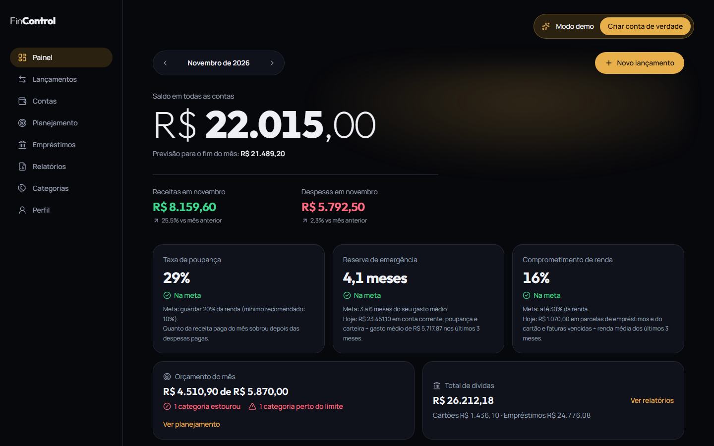
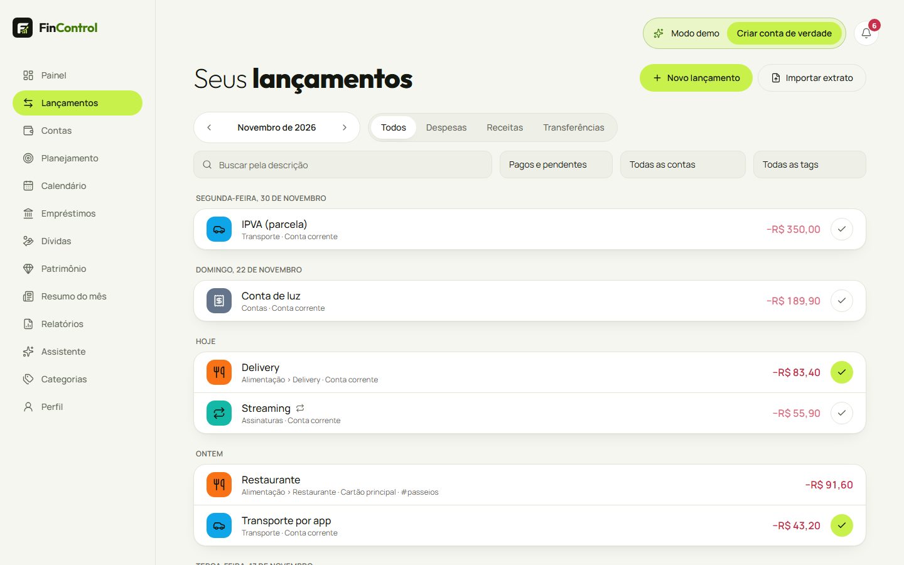
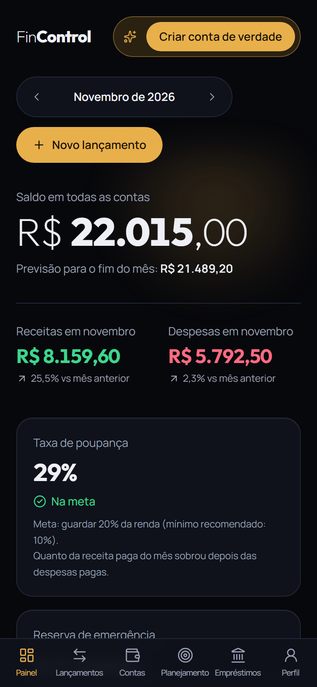
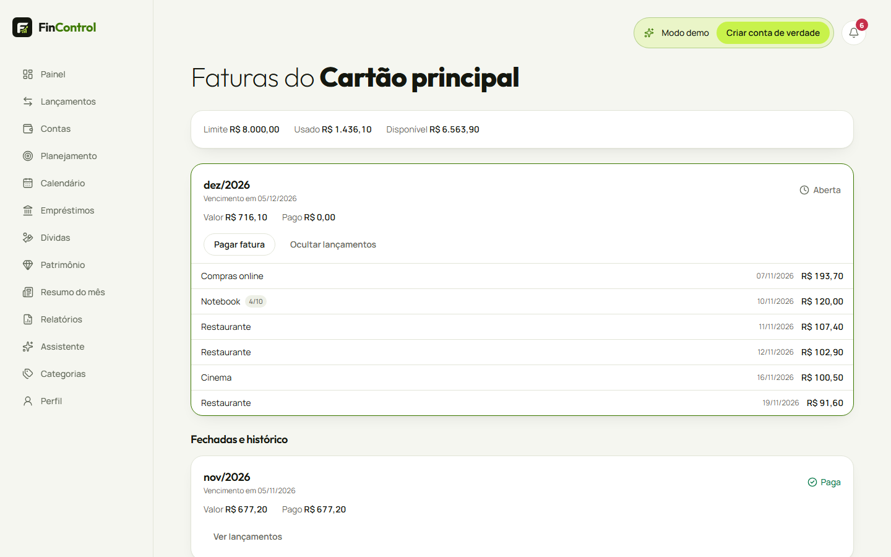
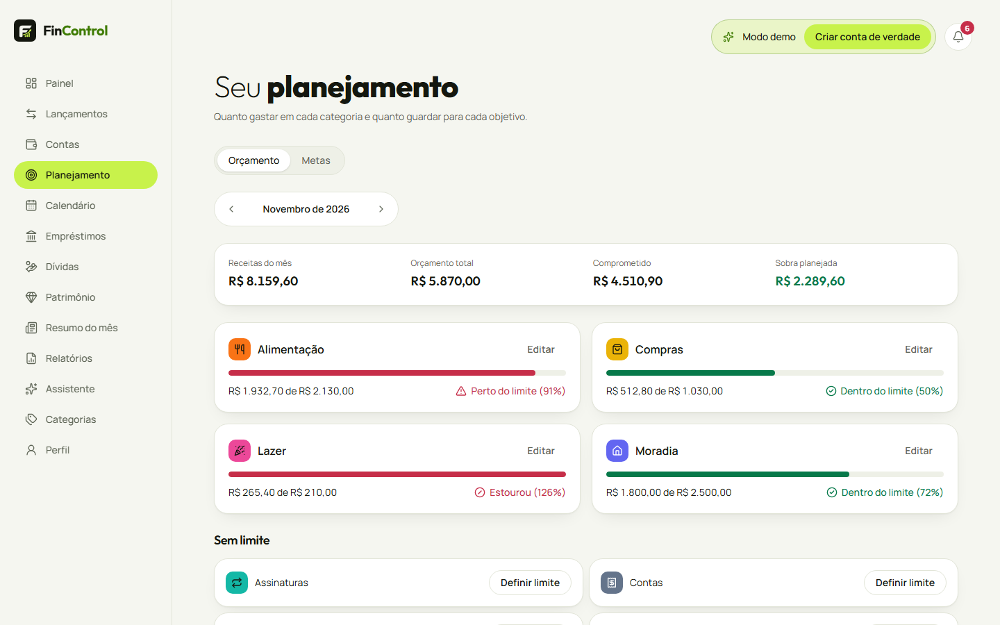
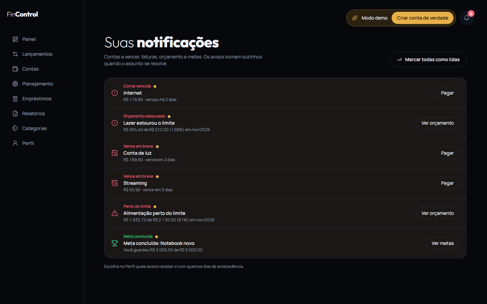
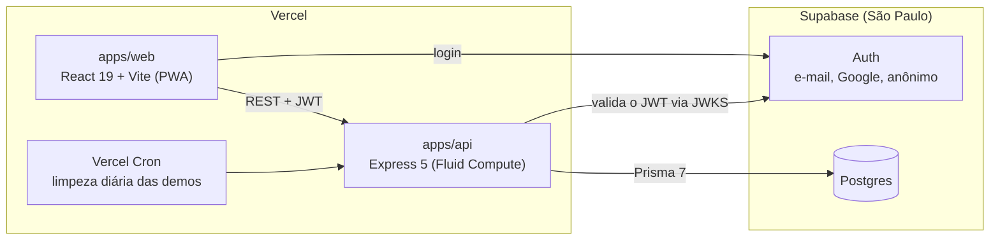

# FinControl

[](https://github.com/GabrielBotelhoeng/FinControl/actions/workflows/ci.yml)

Gestão financeira pessoal: contas, cartões de crédito, empréstimos e financiamentos, receitas, despesas, transferências, recorrências e um painel do mês. Web responsivo e PWA instalável, em português e em reais. É um projeto de portfólio.

**[Abrir o app →](https://fincontrol-gb.vercel.app)** · Clique em **“Experimentar sem cadastro”** para entrar numa demo própria, com 6 meses de dados. Nada precisa ser preenchido.



<table>
  <tr>
    <td width="62%"></td>
    <td></td>
  </tr>
</table>









## O que dá para fazer

- **Várias contas**: corrente, poupança, carteira e investimento, cada uma com o próprio saldo, além de transferências entre elas.
- **Cartões de crédito**: limite total e disponível, dia de fechamento e de vencimento, e a conta que paga a fatura. Cada compra cai na fatura certa, inclusive no dia do fechamento e em meses curtos. Compras parceladas (até 48x) espalham as parcelas pelas faturas seguintes, e a soma bate com o total ao centavo.
- **Faturas**: aberta, fechada, paga ou vencida, sempre com ícone e texto. Pagar a fatura é uma transferência da conta pagadora para o cartão, que devolve o limite. Pagar a mais reduz a dívida do cartão.
- **Empréstimos e financiamentos**: a pessoa informa o que sabe (valor recebido, valor da parcela e número de parcelas) e o app descobre a taxa de juros real, ao mês e ao ano. Ele mostra quanto ela vai devolver e quanto disso é juros, o saldo devedor e a quitação antecipada estimada (CDC art. 52 §2º). As parcelas restantes entram como lançamentos pendentes, e pagar uma delas atualiza o progresso.
- **Dívidas com credores**: crediário, conta atrasada, imposto ou dinheiro emprestado de alguém. A pessoa informa o valor original e, quando o credor manda um valor novo, atualiza. O app separa juros e multas, descontos e o que já foi pago. Ela registra as negociações (o que ofereceram, quanto), fecha um acordo com entrada e parcelas, que entram em Lançamentos, e acompanha o progresso até quitar.
- **Plano de quitação**: simula pagar todas as dívidas com um valor por mês e compara avalanche (maior juros primeiro), bola de neve (menor saldo primeiro) e só as parcelas, com a data de quitação, os juros de cada caminho e o gráfico do saldo devedor.
- **Comparação com o Banco Central**: a taxa do contrato é comparada com a do próprio banco e com a mediana do mercado para o mesmo tipo de crédito, com a fonte e o período de referência. As taxas oficiais são sincronizadas toda semana.
- **Orçamento por categoria**: um limite mensal por categoria de despesa, com o comprometido do mês (pago + a pagar) e a situação escrita (dentro, perto do limite ou estourou). Mostra a sobra planejada (receitas do mês − orçamento) e a previsão dos próximos 3 meses. O limite sugerido é a média dos últimos 3 meses.
- **Metas**: objetivos com valor e prazo, depósitos e retiradas, percentual alcançado, situação (no ritmo, atrasada, concluída) e quanto guardar por mês até o prazo. Há um atalho para a meta de reserva de emergência, com 6 meses do gasto médio.
- **Relatórios**: por mês, ano ou últimos 12 meses, com resumo e taxa de poupança, gastos e receitas por categoria comparados com o período anterior, evolução mensal, evolução das dívidas (cartões com parcelas futuras, saldo devedor dos empréstimos e dívidas com credores), maiores despesas e o saldo de cada conta no fim do período.
- **Exportação**: o relatório em PDF (A4, gerado na API), uma **planilha de análise em Excel** (lançamentos em tabela com filtros, variações em fórmula, "onde o dinheiro vai" por descrição, dia da semana, pequenos gastos, fixos e variáveis, ano contra ano) e os lançamentos em CSV no formato do Excel brasileiro (`;`, vírgula decimal, acentos certos e proteção contra fórmulas).
- **Notificações**: um sino em todas as telas com os avisos não lidos: contas vencidas e a vencer, faturas fechadas ou vencidas, categorias perto do limite ou estouradas e metas concluídas. Os mais urgentes vêm primeiro, cada aviso leva à tela que resolve o assunto e some sozinho quando ele se resolve. No Perfil, a pessoa escolhe o que receber e com quantos dias de antecedência, e pode ligar os **avisos no celular e no navegador** (Web Push): todo dia às 8h, uma mensagem com o que é novo.
- **Calendário de contas**: o mês em grade, com o que vence em cada dia (contas, receitas e faturas do cartão), os totais a pagar e a receber e o botão de pagar ali mesmo.
- **Resumo do mês**: em poucas frases, quanto gastou contra o mês anterior, quanto sobrou, a categoria que mais subiu e a que mais caiu, a maior despesa, o orçamento e as dívidas.
- **Lançamentos**: receitas e despesas, fixas ou variáveis, pagas ou pendentes, com vencimento e categoria.
- **Recorrências**: o lançamento se repete (toda semana, todo mês ou todo ano) e cada mês ganha a sua ocorrência, que pode ser paga ou editada. Dá para editar “só esta” ou “esta e as próximas”, sem mexer no que já foi pago.
- **Histórico com filtros combinados**: período, conta, categoria, tipo, situação e busca, com paginação.
- **Painel**: saldo total, total de dívidas, previsão para o fim do mês, receitas e despesas comparadas com o mês anterior, evolução de 6 meses, gastos por categoria e contas a pagar, com as faturas de cartão em aberto.
- **Saúde financeira**: taxa de poupança (meta de 20%), reserva de emergência em meses de gasto (meta de 3 a 6) e comprometimento de renda com parcelas de empréstimos e do cartão e faturas vencidas (meta de até 30%). Cada indicador mostra a situação por escrito e a conta que gerou o número.
- **Demo isolada por visitante**: cada pessoa recebe uma conta anônima com dados próprios, apagada automaticamente após 7 dias.
- **Login** por e-mail e senha ou pelo Google. Em **Perfil → Excluir minha conta**, a pessoa apaga tudo, como prevê a LGPD ([política de privacidade](https://fincontrol-gb.vercel.app/privacidade)).

## Arquitetura



- **A API é dona das regras de negócio.** O Supabase entra só como infraestrutura (Postgres e Auth). O front faz o login e a API valida o JWT pela chave pública (JWKS), sem chamar o Auth a cada requisição.
- **Dinheiro em centavos inteiros** (`BIGINT`), sem `float`, para não haver erro de arredondamento.
- **Recorrências materializadas sob demanda** e de forma idempotente. Não existe job pré-gerando ocorrências, e uma ocorrência persistida pode ser paga e editada.
- **Monorepo com npm workspaces.** Os schemas Zod de `packages/shared` validam os dados nos dois lados.

As decisões, com as alternativas descartadas e os motivos, estão nas specs do [sub-projeto 1](docs/superpowers/specs/2026-11-11-fincontrol-fundacao-fluxo-caixa-design.md) , do [sub-projeto 2](docs/superpowers/specs/2026-11-12-fincontrol-sp2-credito-design.md), do [sub-projeto 3](docs/superpowers/specs/2026-11-16-fincontrol-sp3-planejamento-metas-design.md), do [sub-projeto 4](docs/superpowers/specs/2026-11-17-fincontrol-sp4-relatorios-exportacao-design.md) e do [sub-projeto 5](docs/superpowers/specs/2026-11-17-fincontrol-sp5-notificacoes-design.md).

- **O cartão é uma conta** do tipo `credit_card`. A compra é uma despesa nessa conta, com o mês da fatura gravado, e o pagamento é uma transferência. Assim, cartão, saldo e painel usam o mesmo livro-caixa.
- **As contas do empréstimo ficam em `packages/shared`** (tabela Price): a API calcula o detalhe, e o formulário mostra a taxa real antes de salvar com as mesmas funções.
- **O PDF é gerado na API com `pdf-lib`**, JavaScript puro com as fontes padrão embutidas, sem ler arquivos do disco na função da Vercel. O download usa `fetch` com o token, para ele nunca ir parar na URL.
- **Web Push sem serviço externo** (VAPID, biblioteca `web-push`): a API só aceita endereços de assinatura dos serviços de push conhecidos (contra SSRF), e cada aviso vai por push uma vez só.
- **Notificações calculadas na hora:** cada aviso sai dos dados atuais, e o banco guarda só a memória dele (chave estável, quando apareceu e quando foi lido). Assim, um aviso de conta já paga nunca fica para trás.
- **Taxas do Banco Central** vêm da API Olinda (`taxaJuros` v2). Um cron semanal guarda o período mais recente de cada modalidade. Se a API falhar, os dados anteriores ficam. Os testes usam respostas gravadas, sem rede.

| Pasta | O que tem |
|---|---|
| `apps/web` | React 19, React Router 7, TanStack Query, React Hook Form, Tailwind 4, Recharts, PWA |
| `apps/api` | Express 5, Prisma 7 (PostgreSQL), Zod, jose (JWT), pino, helmet, rate limit |
| `packages/shared` | Schemas Zod, tipos e utilitários de datas e dinheiro compartilhados |
| `e2e` | Testes ponta a ponta com Playwright |
| `supabase` | Configuração versionada do Auth (`supabase config push`) |

## Testes

| Camada | Quantidade | Como roda |
|---|---|---|
| `packages/shared` | 129 | Unitários (Vitest) |
| `apps/api` | 260 | Integração contra **Postgres real**: rotas HTTP, regras de saldo, recorrência, cartão e fatura, empréstimos, relatórios, CSV e PDF, sincronização com o Banco Central e isolamento entre usuários |
| `apps/web` | 172 | Componentes e fluxos (Testing Library), com o provedor de identidade simulado |
| `e2e` | 13 | Chromium contra a pilha inteira |

O E2E roda a **web buildada como em produção**, a **API real** e o **Postgres real**. A única peça simulada é o provedor de identidade: um servidor Auth mínimo ([`e2e/fake-auth.ts`](e2e/fake-auth.ts)) que fala o mesmo protocolo do Supabase e assina JWTs ES256 de verdade. Assim, a API valida os tokens pelo mesmo caminho de produção (JWKS, issuer e audience), sem segredos no CI e sem sujar o projeto real. Os cenários seguem os critérios de aceite da spec:

- demo em um clique;
- cadastro, conta e despesa paga, com o saldo da conta atualizado;
- recorrência mensal sem duplicar ao navegar e recarregar;
- compra no cartão indo para a fatura, e o pagamento tirando da corrente e devolvendo o limite;
- limite por categoria avisando "Perto do limite", e meta acompanhando os depósitos;
- cadastro de empréstimo com a taxa real na prévia, as parcelas em Lançamentos e a exclusão apagando as pendentes;
- relatórios da demo, com o download do CSV e do PDF;
- notificações da demo: a ação marca como lido, "marcar todas" zera o contador e as preferências do Perfil valem na hora;
- “Excluir minha conta” apagando também o usuário no Auth;
- nenhuma rolagem horizontal nem conteúdo cortado a 360 px, em todas as páginas, inclusive no cabeçalho;
- política de privacidade e termos de uso públicos;
- rota protegida sem sessão.

O CI ([`ci.yml`](.github/workflows/ci.yml)) roda lint, typecheck, os testes e o E2E em toda PR. Cada PR também ganha um deploy de preview da web e da API na Vercel.

## Rodando localmente

Pré-requisitos: Node 22 e Docker.

```bash
npm install
npm run db:up                                   # Postgres na porta 5435 (bancos de dev e de teste)
cp apps/api/.env.example apps/api/.env          # e preencha as variáveis do Supabase
cp apps/web/.env.example apps/web/.env.local
npm run db:migrate                              # migrations no banco de dev
npm run dev:api                                 # http://localhost:3333/api/v1/health
npm run dev -w @fincontrol/web                  # http://localhost:5173
```

## Qualidade

```bash
npm run lint
npm run typecheck
npm test                                        # unitários e integração (precisa do db:up)
npx playwright install chromium                 # só na primeira vez
npm run test:e2e                                # sobe auth falso, API e web buildada, e roda o Playwright
SCREENSHOTS=1 npm run test:e2e -- screenshots   # regenera as imagens deste README
```

## Deploy

Dois projetos na Vercel a partir deste monorepo: `fincontrol-web` (raiz `apps/web`) e `fincontrol-api` (raiz `apps/api`). Ambos estão ligados ao GitHub, com produção na `main` e preview em cada PR.

- A API usa `src/index.ts` como entrada (`export default app`) e precisa de `VERCEL_EXPERIMENTAL_BACKENDS=1`, por causa dos imports sem extensão e do pacote `shared` em TypeScript.
- Os crons (`apps/api/vercel.json`) chamam `/api/v1/internal/cron/cleanup-demo` todo dia e `/api/v1/internal/cron/sync-bank-rates` toda segunda-feira, protegidos por `CRON_SECRET`.
- A API aceita a origem de produção e, via `WEB_PREVIEW_ORIGIN_PATTERN` (regex ancorada), os previews da web.
- A conexão com o Postgres valida o certificado e o nome do host contra a CA do Supabase (`DATABASE_CA_CERT`), e não apenas cifra o tráfego.

## Roadmap

São 7 sub-projetos. O 1 (fundação e fluxo de caixa), o 2 (crédito: cartões, empréstimos e financiamentos), o 3 (planejamento e metas), o 4 (relatórios e exportação) e o 5 (notificações na central e no celular) estão prontos. Depois vem um assistente financeiro com IA. Cada um sai com spec, plano, testes e deploy.
